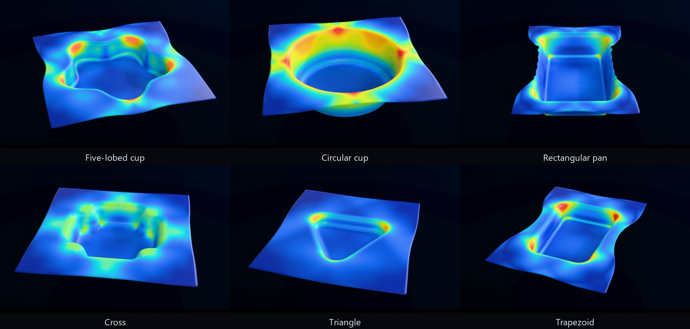
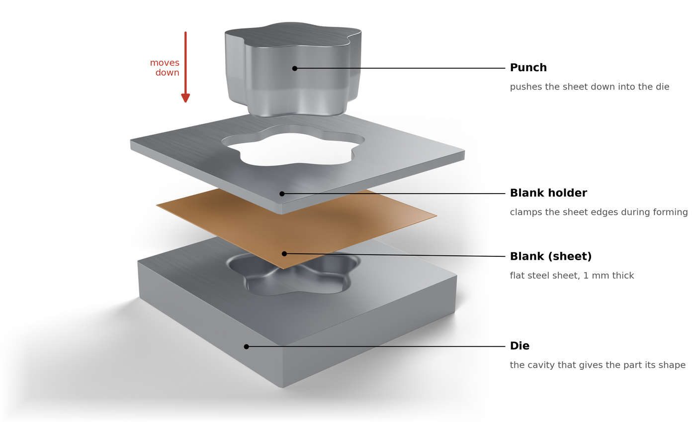
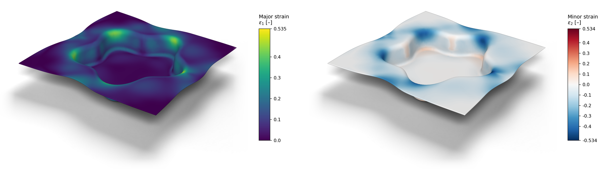

# Synthetic Deep Drawing Dataset Generator

<p align="center">
  <a href="docs/media/tool_construction_1080p.mp4">
    
  </a>
</p>

**How a tool set is built.** One plan contour, here a five-lobed cup
`r(θ) = R + A·cos 5θ`, is offset into the die opening and the blank edge. Copies
of that contour are stacked along a section profile and skinned into a
structured quad mesh, first for the punch, then for the die, the blank holder
and the blank. The four pieces are then combined into the tool set that goes
into the solver deck. Click the animation for the 1080p version; it is rendered
in Blender from the generator's own geometry and uses no solver output.

<p align="center">
  
</p>

A reproducible Python and LS-DYNA pipeline for generating parametric
deep-drawing datasets. It builds tool geometry and solver decks, runs resumable
parameter sweeps, validates each simulation, and exports point clouds plus the
full deformed sheet mesh for machine-learning workflows.

The project supports three geometry groups:

- rectangular box draws;
- U-channels with independently parameterized end sections; and
- cups with circular, elliptical, rectangular, polygonal, lobed, cross, and
  trapezoidal plan outlines.

## Formed geometries



Every part above is the final, pre-springback state of its own refined-mesh
simulation, generated from a single parametric outline. Colours show major
strain on one shared scale so the parts can be compared; the scale is tuned for
illustration and each part is shown at the same display size. Quantitative
plots follow below.

## The tool set



Punch, blank holder and die are generated together from the same outline as
exact offsets of one another, so the three tools always match the part.

## Strain fields



Major strain (left, linear scale from zero to the maximum) and minor strain
(right, diverging scale centred on zero: blue is compression, red is tension)
at the end of forming. The minor strain shows the flange compressed
circumferentially at the lobe junctions as it draws in. The colours are applied
to the solver values directly, with no lighting on them, so a colour on the part
is exactly the colour on the bar.

> The material card is a documented engineering assumption representative of
> mild deep-drawing steel, not a calibrated grade, so the location of the strain
> concentrations is more reliable than their absolute magnitude.

## LS-DYNA licence notice

This repository does not include LS-DYNA. Anyone running the pipeline must
obtain their own licence and use it under its terms.

The tool-construction animation is geometry only and uses no solver output. The
forming animation and the figures above were produced with the free **Ansys LS-DYNA
Student** edition as part of a student project and are shown here for
demonstration only. Ansys limits the Student edition to student instruction,
student projects and student demonstrations: results produced with it should not
be used in publications, research data releases or commercial work. For any of
those purposes, use an appropriate academic research or commercial licence and
re-run the simulations under it. See the
[Ansys academic usage terms](https://ansys.synopsys.com/legal/terms-and-conditions/academic-usage).

Generated data and LS-DYNA binaries are intentionally not stored in this Git
repository. A full working directory can be many gigabytes; the repository
contains the code, material assumptions, configuration, and documentation needed
to reproduce it.

## What the pipeline produces

For each tool geometry and process setting, the pipeline exports:

- initial-state point clouds for the blank, die, binder, and punch;
- a final-state part point cloud;
- the full deformed quadrilateral mesh and per-element thickness;
- the parameters needed to rebuild the case; and
- a machine-readable acceptance report with termination, thinning, energy,
  hourglass, and binder-closure checks.

The output is compatible with the naming and folder conventions used by the
reference StampFormer-style dataset. See [the data-format reference](docs/data-format.md)
for the complete schema.

## Requirements

- Python 3.10 or newer
- Windows for the included LS-DYNA discovery helper
- LS-DYNA, installed and licensed separately, to run simulations
- LS-PrePost, optional, to inspect animation output

Geometry construction, sampling, deck generation, and dry runs can be used
without an LS-DYNA installation.

## Installation

```powershell
git clone https://github.com/ayoub8rouine/synthetic-deep-drawing-dataset.git
cd synthetic-deep-drawing-dataset

python -m venv .venv
.\.venv\Scripts\Activate.ps1
python -m pip install --upgrade pip
python -m pip install -r requirements.txt
```

Check whether the solver can be found and run:

```powershell
.\scripts\diagnose_lsdyna.ps1
```

You can always pass an executable explicitly with `--solver` when running a
sweep. The LS-DYNA Student edition supports at most four SMP cores, so the
default `--ncpu 4` is deliberate.

## Quick start

Build one rectangular case without launching the solver:

```powershell
python .\meshing\build_forming_deck.py `
  --out .\simulations\dev_case `
  --height 25 `
  --bhf 200000
```

Preview a small, reproducible sweep:

```powershell
python .\scripts\run_sweep.py --grid pilot --dry-run
```

Run it when LS-DYNA is available:

```powershell
python .\scripts\run_sweep.py --grid pilot
```

The sweep is resumable. Existing completed samples are skipped, and
`simulations/sweep/sweep_manifest.json` is updated after each case.

## Generate each geometry family

### Rectangular box draws

```powershell
python .\scripts\run_sweep.py --grid pilot
python .\scripts\run_sweep.py --grid medium
python .\scripts\run_sweep.py --grid reference
```

| Grid | Runs | Approximate wall time on 4 cores |
| --- | ---: | ---: |
| `pilot` | 6 | 10 minutes |
| `medium` | 81 | 2-3 hours |
| `reference` | 1,440 | 2-3 days |

### Multi-outline cups

```powershell
python .\shapes\pipeline.py --sample
python .\shapes\pipeline.py --case 0
python .\shapes\pipeline.py --run
```

Add `--seed <number>` to generate a different reproducible Latin-hypercube
sample. See [shapes/README.md](shapes/README.md) for the outline registry,
process-window constraints, and guidance for adding a shape.

### U-channels

```powershell
python .\u_shape\pipeline.py --sample
python .\u_shape\pipeline.py --case 0
python .\u_shape\pipeline.py --run
```

Both end sections are sampled independently, allowing straight and tapered
channels in the same dataset.

## Analyze the output

```powershell
# Audit coverage and acceptance metrics.
python .\postprocessing\summarize_dataset.py --csv summary.csv

# Render one generated case.
python .\postprocessing\plot_case.py .\dataset\<case> `
  --force 300000 `
  --out case.png

# Export accepted parts for a 3-D viewer.
python .\postprocessing\export_trellis.py --all --format glb
```

The default output roots are:

| Family | Dataset | Solver runs |
| --- | --- | --- |
| Box | `dataset/` | `simulations/` |
| Cups | `shapes/dataset/` | `shapes/simulations/` |
| U-channel | `u_shape/dataset/` | `u_shape/simulations/` |

These directories are ignored by Git because they contain large generated
artifacts.

## Repository layout

```text
geometry/        Parametric box geometry and reference validation
materials/       Documented material assumptions
meshing/         LS-DYNA keyword-deck generation
postprocessing/  Extraction, checks, summaries, plots, and viewer exports
scripts/         Sweeps, diagnostics, convergence studies, and showcases
shapes/          Multi-outline cup geometry and sampling pipeline
u_shape/         U-channel geometry and sampling pipeline
templates/       Small solver smoke-test input
docs/            Method notes, audits, and format documentation
```

## Geometry convention

The box model is a double-action inverted draw on one symmetry quarter
(`x >= 0`, `y >= 0`). The blank midsurface begins at `z = 0` with thickness
`t`. The die and binder travel downward by the draw height while the punch is
fixed. At the end of the stroke, the flange is near `z = -height` and the cup
bottom is near `z = 0`.

```text
      die          upper female tool; flange face at +t/2
    --------
 ==== blank ====   midsurface at z = 0
    --------
 punch   binder    punch top face at -t/2
```

Units are millimetres, seconds, tonnes, newtons, and megapascals. The default
models stay below the LS-DYNA Student node limit.

The reference box-case folder tokens map as follows:

| Token | Meaning |
| --- | --- |
| `radii2` | Plan corner radius of the box |
| `radii1` | Punch nose, die entry, and cavity-roof profile radius |
| `cr` | Clearance ratio; the one-sided die gap is `cr * thickness` |
| `delta` | Total lateral draft inset over the draw height |
| `height` | Draw depth |

## Acceptance checks

A run is written to the dataset only when it passes all configured checks:

- normal solver termination;
- maximum thinning below 30 percent;
- kinetic/internal energy below 5 percent once forming work is established;
- total-energy ratio within `1 +/- 0.10`;
- hourglass energy below 10 percent of internal energy; and
- final binder-to-die gap below 1 mm.

The thresholds and measured values are retained in each
`case_report_<force>.json`; downstream users should still select limits
appropriate to their application.

## Reference-data validation

The optional validation scripts compare generated box tooling and parts against
a separately obtained reference dataset. Point them at its `Dataset` directory:

```powershell
python .\geometry\verify_reference.py `
  --reference "D:\data\reference-deep-drawing\Dataset" `
  --all

python .\postprocessing\compare_to_reference.py `
  --reference "D:\data\reference-deep-drawing\Dataset"
```

The external reference dataset is not distributed by this repository. Existing
project measurements reported mean straight-region tool residuals of 0.128 mm
for the punch, 0.087 mm for the die, and 0.000 mm for the binder over 228 cases.
Part comparisons measured a 2.9 mm mean Chamfer distance against an approximately
1.1 mm independent-sampling floor.

## Important modeling choices

- Tool shell thickness is 0.1 mm. Contact offsets each surface by half its shell
  thickness; thicker tool shells can unintentionally close the blank gap.
- The punch extends below the forming depth so the binder does not descend past
  its supporting surface at bottom dead centre. This prismatic tool extension is
  excluded from the exported point cloud.
- The default binder opening follows the die flange face. Set
  `binder_opening="cavity"` when reproducing the external reference tools.
- Blankholder pressure is the physically comparable quantity across different
  plan shapes. A raw force is meaningful only with its associated clamped area
  and symmetry share.

## Reproducibility and storage

Parameter samples are deterministic for a fixed seed. Every accepted case
retains its parameters and quality report. Solver versions, platform details,
and proprietary executables are not bundled, so record them when publishing a
derived dataset.

GitHub rejects individual files larger than 100 MB and is not a suitable host
for multi-gigabyte solver results. Publish dataset releases through a data
repository such as Zenodo, Figshare, or Hugging Face Datasets, then add the DOI
or download URL here. Keep the generator source in Git.

## Contributing and license

See [CONTRIBUTING.md](CONTRIBUTING.md) for local checks and repository hygiene.

No open-source license has been selected yet. Until a `LICENSE` file is added,
copyright law reserves reuse and redistribution rights to the copyright holder.
Choose a license before announcing the repository for third-party reuse.
